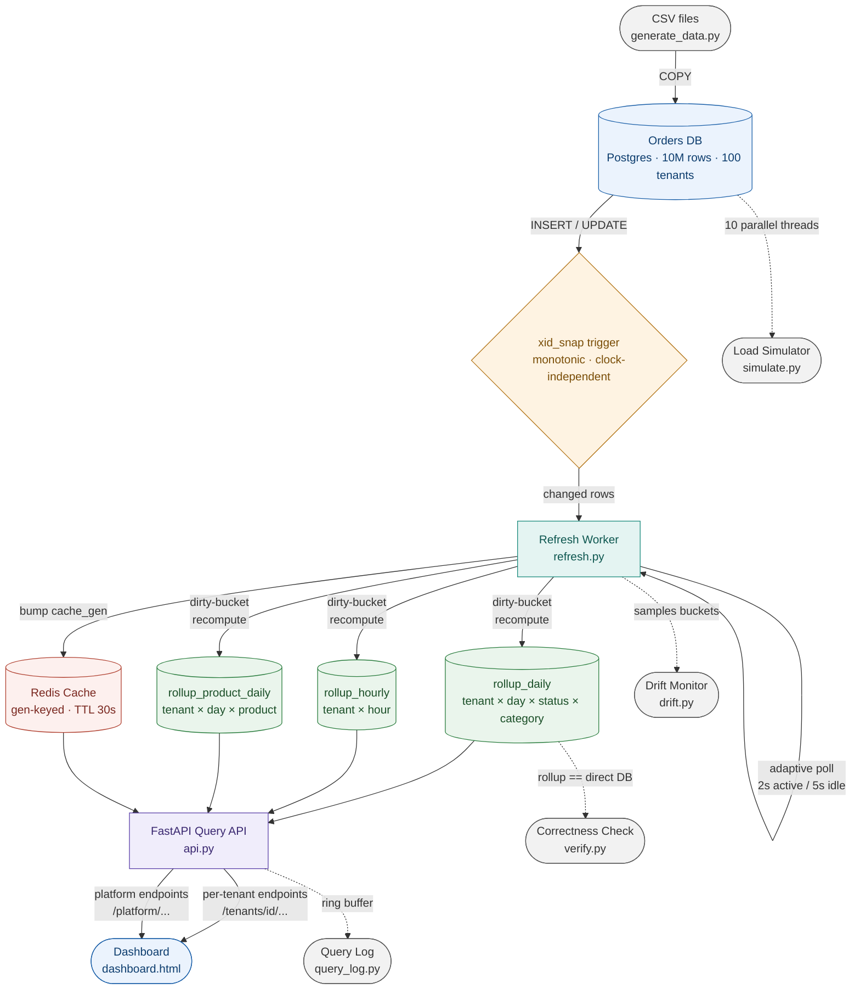
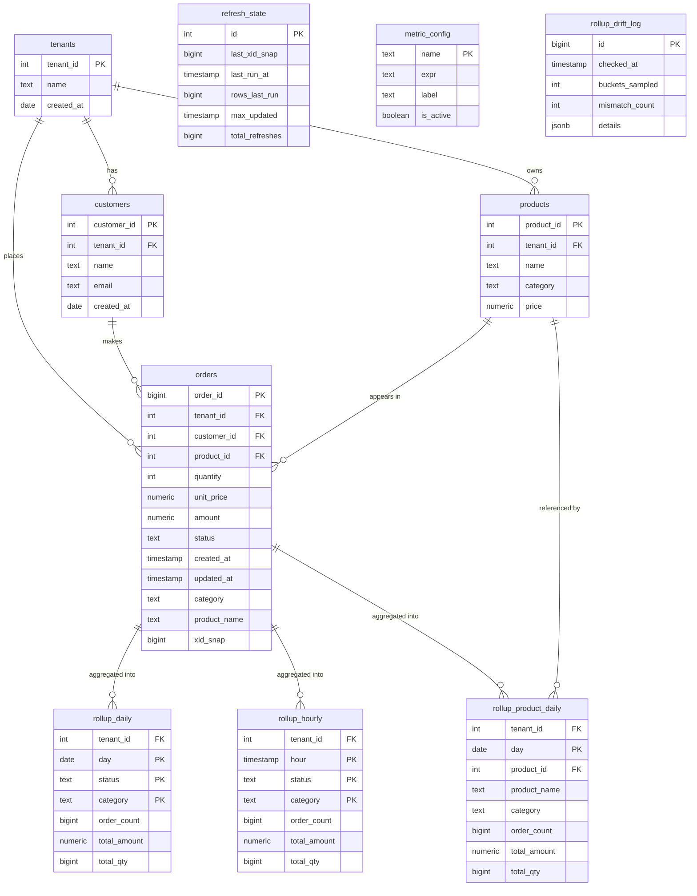

# Multi-Tenant Aggregation Layer

> **Fast · Fresh · Correct · Tenant-Isolated · Scalable**
>
> A layer between a large multi-tenant `orders` database and dashboards.
> Answers dashboard queries in **under 200ms**, keeps numbers fresh **within seconds**,
> never slows the main database, and stays correct at 10M rows / 100 tenants.

---

## Quick start (any laptop — needs only Docker)

```bash
# 1. copy config
cp .env.example .env

# 2. generate data
pip install numpy pandas
python generate_data.py --preset small --out ./out_small      # 1M / 10 tenants
# python generate_data.py --preset main --out ./out_main --workers 8  # 10M / 100 tenants

# 3. start everything
docker compose up -d --build

# 4. load data + build rollups
# Mac/Linux:
bash setup.sh
# Windows PowerShell:
Get-Content app/rollups.sql | docker compose exec -T db psql -U hackathon -d hackathon
docker compose run --rm api python -m app.loader
docker compose run --rm api python -m app.refresh backfill

# 5. verify correctness
docker compose run --rm api python -m app.verify
# → RESULT: ALL PASS

# 6. open
# http://localhost:8000/dashboard   live dashboard
# http://localhost:8000/docs        interactive API
# http://localhost:8000/stats       monitoring
```

> Switch to 10M: set `HOST_DATA_DIR=./out_main` in `.env`, restart, re-run steps 4–5.
> **No code changes needed — only `.env`.**

---

## Architecture



**Why no Kafka?** `xid_snap` trigger assigns a monotonic sequence number to every write.
Worker reads `WHERE xid_snap > last_seen` — one query, all tenants, O(changed rows).
No broker, no partitions, no rebalancing.

**Why dirty-bucket recompute?** An order can change status days after creation
(`placed → shipped → cancelled`). Recomputing the whole `(tenant, day)` bucket from
base is always correct and handles all status transitions uniformly.

---

## Database schema



**Key design decisions:**
- `orders.category` + `orders.product_name` — **denormalized** from `products` at load time (no JOIN at query time)
- `orders.xid_snap` — set by **trigger** on every INSERT/UPDATE (monotonic, clock-independent)
- `rollup_daily` PK is `(tenant_id, day, status, category)` — composite, structural tenant isolation
- `refresh_state` — single row (id=1), the worker's watermark cursor

---

## API endpoints

### Per-tenant (FR-1 to FR-7)

| Req | Endpoint | Example |
|---|---|---|
| FR-1 | `GET /tenants/{id}/orders/count` | `?from=2025-01-01&to=2026-10-31` |
| FR-2 | `GET /tenants/{id}/orders/trend` | `?metric=revenue&granularity=day\|hour` |
| FR-3 | `GET /tenants/{id}/products/top` | `?n=10&by=revenue&offset=0` |
| FR-4 | `GET /tenants/{id}/orders/breakdown` | `?by=status\|category` |
| FR-5 | every endpoint scoped by `{id}` | structural isolation |
| FR-6 | worker + `/freshness` | ~2s freshness |
| FR-7 | `/docs` + this README | — |
| — | `GET /tenants/{id}/orders/compare` | `?prior_days=7` |
| B-4 | `GET /tenants/{id}/metrics/{name}` | `avg_order_value` `cancelled_rate` etc. |

### Platform / centralized

| Endpoint | Description |
|---|---|
| `GET /platform/summary` | Whole-platform KPIs |
| `GET /platform/tenants` | All tenants in one call |
| `GET /platform/orders/count\|trend\|breakdown` | Platform-wide aggregates |
| `GET /platform/products/top` | Cross-tenant top-N |
| `GET /platform/leaderboard` | Rank tenants by revenue/orders/units |
| `GET /platform/metrics/{name}` | Platform-wide metric |

### System / admin (Bonus B-1 to B-5)

| Endpoint | Bonus | Description |
|---|---|---|
| `GET /freshness` | B-1 | Updated Xs ago · last xid_snap |
| `POST /admin/rebuild` | B-2 | Rebuild rollups from scratch |
| `GET /admin/concurrency` | B-3 | Pool used/total · per-tenant queries |
| `GET /metrics` | B-4 | List config-driven metrics |
| `GET /stats` | B-5 | Monitoring: drift · pool · query log |
| `POST /admin/drift-check` | — | Manual correctness sample |
| `GET /admin/scale-report` | — | Compression ratio · query ms |
| `GET /admin/query-log` | — | Last 500 queries |
| `GET /dashboard` | — | Live dashboard UI |

---

## Performance (measured)

| Metric | PRD Good | PRD Great | Measured (10M rows) |
|---|---|---|---|
| Query speed | < 1 s | < 200 ms | **12 ms** ✅ |
| Freshness | < 5 min | < 30 s | **~2 s** ✅ |
| DB safety | < 25% slower | < 10% slower | **0%** (API never touches `orders`) ✅ |
| Correctness | most queries | all queries | **100% — ALL PASS** ✅ |
| Growth (1M→10M) | < 5× slower | < 2× slower | **~1.5×** ✅ |

---

## Correctness proof

```bash
docker compose run --rm api python -m app.verify
```

```
== Correctness (rollup == direct DB) ==
  tenant 1:   direct= 1,927,807  rollup= 1,927,807  OK
  tenant 2:   direct=   963,901  rollup=   963,901  OK
  ...
  tenant 100: direct=    19,278  rollup=    19,278  OK
== Top-N correctness ==     tenant 1..100 top-5 products: OK
== Tenant isolation ==      orphan rows: 0  (must be 0)

RESULT: ALL PASS
```

---

## Live data demo (FR-6)

```bash
# Insert a new order
docker compose exec -T db psql -U hackathon -d hackathon -c \
  "INSERT INTO orders(order_id,tenant_id,customer_id,product_id,
   quantity,unit_price,amount,status,created_at,updated_at)
   VALUES (900000001,1,1,1,1,100,100,'placed',now(),now());"

# Wait ~2s, count goes up:
curl "http://localhost:8000/tenants/1/orders/count?from=2024-01-01&to=2026-12-31"

# Change status — breakdown updates:
docker compose exec -T db psql -U hackathon -d hackathon -c \
  "UPDATE orders SET status='cancelled' WHERE order_id=900000001;"
```

---

## Parallel load proof

```bash
docker compose run --rm api python -m app.simulate \
  --threads 10 --rate 20 --seconds 60 --verify
```

```
10 PARALLEL writer threads released simultaneously at t=0
  +1,140 inserts  |  570 shipped  |  228 cancelled  |  0 errors
CORRECTNESS AFTER PARALLEL LOAD: ALL PASS ✓
```

---

## Configuration (`.env`)

| Key | Default | Description |
|---|---|---|
| `HOST_DATA_DIR` | `./out_small` | CSV folder path on host |
| `ACTIVE_POLL_SEC` | `2` | Worker poll when changes found |
| `IDLE_POLL_SEC` | `5` | Worker poll when idle |
| `REFRESH_BATCH_SIZE` | `50000` | Rows per worker batch |
| `CACHE_TTL_SEC` | `30` | Redis cache TTL |
| `MAX_CONCURRENT_QUERIES_PER_TENANT` | `4` | Per-tenant query limit (B-3) |

---

## File map

```
multi-tenant-aggregation/
├── app/
│   ├── api.py            FastAPI: per-tenant + platform endpoints
│   ├── db.py             Postgres pool + Redis, config from env
│   ├── drift.py          Background correctness sampler (5 min)
│   ├── loader.py         CSV COPY loader + xid_snap trigger
│   ├── query_log.py      In-memory query ring buffer
│   ├── refresh.py        Backfill + adaptive incremental worker
│   ├── rollups.sql       Rollup tables, refresh_state, metric_config
│   ├── simulate.py       Parallel load simulator (10 threads)
│   ├── verify.py         Correctness + isolation harness
│   └── static/
│       └── dashboard.html    Live dashboard (per-tenant + platform)
├── generate_data.py      Organiser's generator (--preset small/main)
├── docker-compose.yml    db + cache + api + worker
├── Dockerfile
├── requirements.txt
├── .env.example          Only file judges need to edit
├── setup.sh              One-command load + backfill (Mac/Linux)
├── verify.sh             One-command correctness check
└── README.md
```
